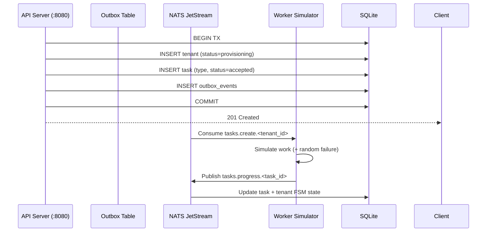

# Tenant Provisioning Control Plane

A **multi-tenant SaaS control plane** built in Go (Gin) with event-driven tenant lifecycle management via NATS JetStream, the Transactional Outbox pattern, and SQLite persistence.

---

## Architecture



### Component Map

| Layer          | Technologies                                                                                                                                                                                    |
|:---------------|:------------------------------------------------------------------------------------------------------------------------------------------------------------------------------------------------|
| API Gateway    | Gin (Go), middleware chain (PanicRecovery → RequestID → Structured Logger)                                                                                                                      |
| Persistence    | SQLite (`go-sqlite3`), schema migrations via `internal/migrate/`                                                                                                                                |
| Event Backbone | NATS JetStream (`tasks.create.>` stream, `tasks.progress.>` subject prefix)                                                                                                                     |
| Reliability    | Transactional Outbox (T18), Idempotent processing via `processed_events` table (T22), Exponential retry + DLQ (T24)                                                                             |
| Guards         | Optimistic locking (`UPDATE ... WHERE version=?`; T9), Tenant FSM validity map (T10), Task FSM terminal-state guards (T11), Open-task concurrency guard (T12), Slug uniqueness constraint (T13) |

---

## Quick Start

Requirements: [Go 1.25+](https://go.dev/dl/), [Docker + Docker Compose](https://docs.docker.com/compose/) (bookworm image).

### 1. Build & Run with Docker Compose

```bash
# Build images and start all services (NATS, API, Worker simulator)
docker compose up --build -d

# Watch logs
docker compose logs -f

# Stop everything (keeps containers, drops data volumes)
docker compose down

# Nuclear reset — nuke volumes too
docker compose down -v
```

### 2. Run End-to-End HTTP Tests

After `docker compose up`, run the bash-based e2e suite:

```bash
bash e2e/test_api.sh
```

Output example:
```
=== 1. GET /healthz ===
  ✓ returns ok

=== 2. POST /v1/tenants (slug+name → 201) ===
  ✓ id=… slug=t-one name=Tenant One
...
ALL CHECKS PASSED
```

### 3. Build & Run Manually (no Compose)

```bash
# ---- Step A: Start NATS JetStream ----
docker run -d --name tpcp-nats \
  -p 4222:4222 -p 8222:8222 \
  -v nats-data:/var/lib/nats \
  nats:2.10-alpine -c /etc/nats-config/nats.conf

# Mount nats-conf.conf into the container:
docker run -d --name tpcp-nats \
  -p 4222:4222 -p 8222:8222 \
  -v nats-data:/var/lib/nats \
  -v $(pwd)/nats-conf.conf:/etc/nats-config/nats.conf \
  nats:2.10-alpine

# ---- Step B: Build the API image locally ----
docker build -t tpcp-api .

# ---- Step C: Run the API server ----
docker run -d --name tpcp-server \
  -p 8080:8080 \
  -e PORT=8080 \
  -e DB_PATH=/app/data/tenant.db \
  -e NATS_URL=nats://host.docker.internal:4222 \
  -e LOG_LEVEL=INFO \
  -v sqlite-data:/app/data \
  tpcp-api

# The server logs "API ready at http://localhost:8080" when up.
```

> **Note:** `DB_PATH` defaults to `/app/data/tenant.db` inside the container and the Dockerfile pre-creates that directory. The DB file survives across restarts because of the named volume.

### Service Ports

| Service        | Port   | Purpose            |
|:---------------|:-------|:-------------------|
| API Server     | `8080` | HTTP REST API      |
| NATS Dashboard | `8222` | JetStream admin UI |

### Environment Variables

| Variable    | Default               | Description                      |
|:------------|:----------------------|:---------------------------------|
| `PORT`      | `8080`                | HTTP listen port                 |
| `DB_PATH`   | `/app/data/tenant.db` | SQLite file path                 |
| `NATS_URL`  | `nats://nats:4222`    | NATS JetStream connection string |
| `LOG_LEVEL` | `INFO`                | Structured logger level          |

---

## API Reference

Base URL: `http://localhost:8080/v1`

### Tenant CRUD

```bash
# Create a tenant → status = provisioning (returns 201)
curl -s -X POST http://localhost:8080/v1/tenants \
  -H 'Content-Type: application/json' \
  -d '{"slug":"acme-corp","name":"Acme Corporation"}'

# List tenants (filter by status)
curl -s 'http://localhost:8080/v1/tenants?status=active&page=1&limit=20'

# Get a tenant by ID
curl -s http://localhost:8080/v1/tenants/<tenant-id>

# Update a tenant (requires correct version for optimistic locking)
curl -s -X PATCH http://localhost:8080/v1/tenants/<tenant-id> \
  -H 'Content-Type: application/json' \
  -d '{"name":"Acme Corp.","version":3,"status":"updating"}'

# Delete a tenant
curl -s -X DELETE http://localhost:8080/v1/tenants/<tenant-id>
```

### Health Check

```bash
curl -s http://localhost:8080/healthz
# → {"status":"ok"}
```

---

## Design Decisions

### Why Go & Gin?
- **Zero GC pauses under load** compared to Python for a control-plane that must handle concurrent tenant provisioning without jitter.
- **Gin's router** gives us explicit handler registration (one file, one `Register` method per resource), keeping the project tree flat and testable.

### Why NATS JetStream over Kafka?
- **Single dependency** instead of a ZooKeeper/KRaft cluster — ideal for a self-contained workshop/demo deployment via Docker Compose.
- **Built-in consumer groups, ack policy, and stream retention** let us implement T20 (worker simulator), T21 (inbound progress consumer), and T24 (retries + DLQ) with fewer infrastructure hoops.

### Why Transactional Outbox?
A direct emit after a DB commit creates a race: the tenant record exists but no event fires. The outbox table solves this by making **emit** merely an atomic DB row. A background fetcher (the worker-sim acts as both publisher and consumer in this demo) picks up `attempts < 10` rows, publishes them, and bumps attempts on failure.

### Why Optimistic Locking?
The control plane must prevent a classic TOCTOU: two API clients reading version `3`, both PATCHing with version `3`. The `UPDATE ... WHERE version=...` guard ensures only the first writer wins; others receive a `409 Conflict`.

---

## Worker Simulator (CLI)

The worker-sim consumes provisioning events and publishes progress updates. Run it standalone:

```bash
go run cmd/worker-sim/main.go --fail-rate=0.2 --max-delay=3s
```

| Flag          | Description                              | Default |
|:--------------|:-----------------------------------------|:--------|
| `--fail-rate` | Probability of a simulated failure (0–1) | `0.0`   |
| `--max-delay` | Max random processing delay              | `5s`    |

In Docker Compose, the worker uses `FAIL_RATE`, `MIN_DELAY_MS`, and `MAX_DELAY_MS` environment variables.

---

## Working with Docker

### Inspect & Debug Containers

```bash
# See running containers
docker ps --filter "name=tpcp-"

# Tail API logs (last 100 lines)
docker logs tpcp-server-1 --tail 100

# Exec into the running API container
docker exec -it tpcp-server-1 sh

# Query the SQLite DB from within the container
docker exec tpcp-server-1 sqlite3 /app/data/tenant.db "SELECT id, slug, status FROM tenants ORDER BY rowid DESC LIMIT 5;"

# Check NATS stream info (requires nats CLI installed)
docker exec tpcp-nats-1 nats --server=nats://localhost:4222 stream info TASKS_CREATE

# Clean up orphaned state between tests
docker compose down -v && docker compose up -d
```

### Worker Simulator in Docker

You can run the worker-sim standalone (useful when you want NATS + API but no simulator):

```bash
# Use pre-built image
docker run --rm \
  -e PORT=8081 \
  -e DB_PATH=/app/data/tenant.db \
  -e NATS_URL=nats://host.docker.internal:4222 \
  -e FAIL_RATE=0.2 \
  -e MIN_DELAY_MS=500 \
  -v sqlite-data:/app/data \
  tpcp-worker-sim

# Or build-and-run in one shot
docker build -t tpcp-worker-sim -f Dockerfile.worker . && docker run --rm \
  -e FAIL_RATE=0.1 -e MIN_DELAY_MS=200 -e MAX_DELAY_MS=1000 \
  -v sqlite-data:/app/data \
  tpcp-worker-sim
```

### Run Everything from Scratch (reproducible)

```bash
# Full teardown → build → start → verify health
docker compose down -v && docker compose up --build -d && sleep 5 \
  && curl -sf http://localhost:8080/healthz && echo " ✓ API is ready"
```

---

## Testing

### E2E HTTP Tests (Docker-first)

Run against the live Docker services:

```bash
bash e2e/test_api.sh        # full lifecycle
bash e2e/test_fix.sh         # targeted fix verification
```

These scripts are designed to work with `docker compose up` — no Go toolchain needed on the host.

### Unit Tests (requires Go 1.25+ locally)

All tests live alongside their source code:

```bash
# FSM validation table-driven tests
go test ./internal/lifecycle -run TestTenantFSM

# Optimistic locking concurrency test (race detector)
go test ./internal/store -run TestOptimisticLockingConcurrency

# Full end-to-end lifecycle
go test ./internal/lifecycle -run TestE2ELifecycle

# All tests, race detector, parallel
go test -race -count=1 ./...
```

### Run Tests Inside Docker (no local Go)

```bash
docker run --rm \
  -v $(pwd):/app \
  -w /app \
  golang:1.25-bookworm \
  go test -race -count=1 ./...
```
